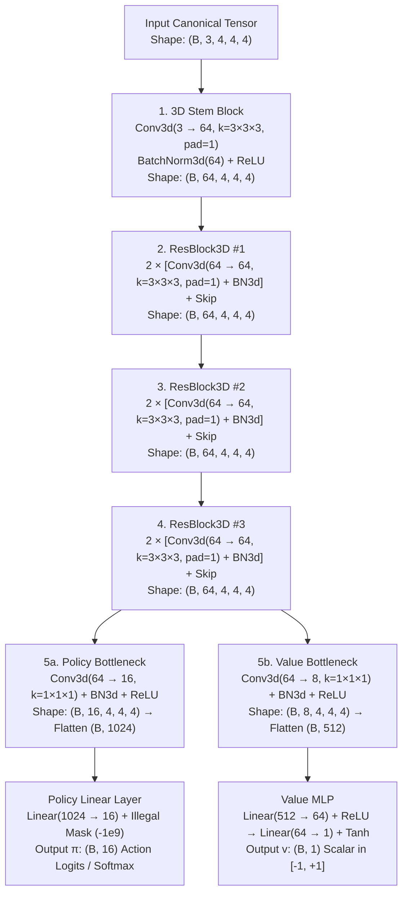
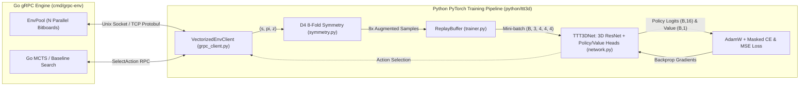

# IMPLEMENTATION — PHASE 4: 3D Residual CNN & Self-Play Reinforcement Learning Pipeline

## 1. Success Criteria for Phase 4

Phase 4 is considered complete and verified when **all** of the following criteria are met:

1. **3D Residual Convolutional Neural Network (`python/ttt3d/network.py`):**
   - Implements `TTT3DNet` (`torch.nn.Module`) accepting canonical 3D board tensors of shape $(B, 3, 4, 4, 4)$ (`float32`):
     - Channel 0: Active player's stones ($1.0$ where present, $0.0$ elsewhere)
     - Channel 1: Opponent's stones ($1.0$ where present, $0.0$ elsewhere)
     - Channel 2: Gravity landing surface ($1.0$ at the exact $(x, y, z)$ landing cell for each legal column move)
   - Uses 3D Residual Blocks (`Conv3d(kernel_size=3, padding=1)` + `BatchNorm3d` + `ReLU` + skip connection) to preserve spatial $4 \times 4 \times 4$ geometry across layers.
   - Splits into two specialized output heads:
     - **Policy Head ($\pi$):** Outputs raw logits of shape $(B, 16)$ over the 16 $(x, y)$ drop columns, plus masked log-probabilities / probabilities setting illegal columns (`valid_mask` bit $= 0$) to $-\infty$ before `softmax`.
     - **Value Head ($v$):** Outputs scalar state-value predictions of shape $(B, 1)$ in $[-1, +1]$ via `tanh`.
   - Supports deterministic inference (`predict`, `select_action`) and model checkpoint saving/loading (`save_checkpoint`, `load_checkpoint`).

2. **8-Fold 3D Dihedral Symmetry Augmentation (`python/ttt3d/symmetry.py`):**
   - Implements the full $D_4$ dihedral symmetry group around the vertical $Z$-axis (4 rotations $\lbrace 0^\circ, 90^\circ, 180^\circ, 270^\circ \rbrace \times 2$ horizontal reflections $= 8$ symmetries).
   - Gravity moves along $Z$, so horizontal rotations and reflections in the $(X, Y)$ plane preserve all 76 winning lines and gravity physics while permuting the 16 $(x, y)$ column actions consistently.
   - Verifies mathematically that transforming a board state in Go by permuting $(x, y)$ moves produces the **exact same** $(3, 4, 4, 4)$ tensor and $16$-action policy vector as `augment_sample(state, policy, value)`.

3. **Vectorized gRPC Python Client (`python/ttt3d/grpc_client.py`):**
   - Connects to the Go `EnvService` gRPC server over Unix Domain Socket (`unix:///tmp/...`) or TCP (`localhost:50051`).
   - Exposes high-throughput NumPy/PyTorch wrappers for `reset`, `step`, `get_state`, `get_win_lines`, `select_action`, `init_pool`, `reset_pool`, and `batch_step`.
   - Zero-copy unpacking of `N * 192` byte buffers into `np.ndarray` of shape `(N, 3, 4, 4, 4)` (`float32`).

4. **AlphaZero-Style Self-Play & Policy-Value Training Pipeline (`python/ttt3d/trainer.py`):**
   - **Replay Buffer (`ReplayBuffer`):** Circular experience buffer storing `(state, policy_target, value_target)` tuples with automatic $8\times$ symmetry expansion.
   - **Data Generation (Teacher-Guided MCTS + Self-Play):** Generates episodes via the Go gRPC engine (supporting both Go MCTS policy/value targets and neural-guided self-play rollouts), assigning terminal outcomes $z \in \lbrace -1, 0, +1 \rbrace$ from the perspective of the player to move at each state.
   - **Combined Policy-Value Loss (`compute_policy_value_loss`):**
     $$\mathcal{L}(\theta) = (z - v_\theta(s))^2 - \boldsymbol{\pi}^T \log \mathbf{p}_\theta(s) + c_{\text{reg}} \|\theta\|_2^2$$
     combining Mean Squared Error (MSE) on the scalar value head and Cross-Entropy loss on the legal-move-masked policy head.
   - **Arena Evaluation (`evaluate_against_baseline`):** Benchmarks `TTT3DNet` against Go baseline agents (`random`, `heuristic`, `mcts`) over gRPC.

5. **Unit & Integration Test Suite ($\ge 90\%$ Coverage in Go & Python):**
   - **Python Unit Tests (`python/tests/test_unit.py`):** Verifies tensor shapes, legal action masking, gradient flow, loss decrease over optimization steps, checkpoint persistence, replay buffer sampling, and all 8 dihedral symmetries.
   - **Python gRPC Integration Tests (`python/tests/test_grpc_integration.py`):** Spins up the real Go `grpc-env` binary as a subprocess over a Unix Domain Socket and verifies:
     - All game rules (Rule 2.1 Grid, Rule 2.2 Turns, Rule 2.3a Gravity, Rule 2.3b Full Column, Rule 2.4a All 76 Winning Lines across Orthogonal/2D/3D categories, Rule 2.4b 64-move Draw) from Python over gRPC.
     - Vectorized `InitPool` / `BatchStep` / `ResetPool` tensor alignment and end-to-end training loop improvement.
   - **Coverage Gate:** Both Go (`go test`) and Python (`pytest --cov=ttt3d --cov-fail-under=90`) achieve **$\ge 90\%$ statement coverage** and run automatically in GitHub Actions CI before PR merge.

---

## 2. Tutor Discussion: Architectural Choices & Deep RL Trade-offs

### 2.1 Why a 3D Convolutional ResNet (`Conv3d`) Instead of an MLP or Vision Transformer?
When designing a neural network for a $4 \times 4 \times 4$ board, we have three primary architectural families:

| Architecture | Inductive Bias | Pros | Cons |
| :--- | :--- | :--- | :--- |
| **Multi-Layer Perceptron (MLP)** | None (flattens $3 \times 4 \times 4 \times 4 \to 192$ vector) | Simple, fast matrix multiplies | Ignores 3D spatial adjacency; must re-learn local $3\times 3\times 3$ neighborhoods independently at every position. |
| **3D Residual CNN (`Conv3d`)** *(Chosen)* | 3D translation equivariance & local spatial connectivity | $3 \times 3 \times 3$ volumetric kernels directly detect local 2-in-a-row / 3-in-a-row threats along all 13 3D directions (axes, planar diagonals, space diagonals); residual skip connections prevent vanishing gradients. | Slightly higher FLOPs per parameter than MLP, though negligible on a $4 \times 4 \times 4$ grid. |
| **3D Transformer (Self-Attention over 64 tokens)** | All-to-all pairwise token interaction with 3D positional encodings | Can attend directly between opposite corners $(0,0,0)$ and $(3,3,3)$ in a single layer. | Quadratic attention overhead ($64^2$) and lacks built-in collinearity bias without heavy data volume. |

- **Why $3 \times 3 \times 3$ `Conv3d` stacks work on a $4 \times 4 \times 4$ grid:** A single $3 \times 3 \times 3$ convolution has a receptive field of $3 \times 3 \times 3$. Stacking just **two** $3 \times 3 \times 3$ layers gives a receptive field of $5 \times 5 \times 5$, which covers the **entire $4 \times 4 \times 4$ cube** from any corner to its opposite corner! Using 3 Residual Blocks (6 `Conv3d` layers total) allows the trunk to first extract local threat segments and then compose them into global forks and double-attack patterns.

### 2.2 Dual-Head Architecture (Policy $\pi$ + Value $v$) vs. Q-Learning (DQN)
In Reinforcement Learning for board games, we could either train:
1. **Action-Value Network (DQN / $Q(s, a)$):** Outputs 16 expected return values, one per column.
2. **Actor-Critic / AlphaZero Dual Head ($\pi(a|s), v(s)$) *(Chosen)*:**
   - **Shared Representation Learning:** Sharing the 3D ResNet trunk between "which move is promising?" ($\pi$) and "who is winning?" ($v$) acts as a powerful regularizer. Features that identify a forced fork simultaneously inform both the winning probability ($v \to +1$) and the exact blocking/winning column ($\pi$).
   - **Clean Separation of Search Prior & Leaf Evaluation:** When combined with MCTS or soft policy targets, the policy head learns a probability distribution (via Cross-Entropy against MCTS visit counts $\boldsymbol{\pi}_{\text{MCTS}}$), while the value head learns a calibrated win/draw/loss expectation in $[-1, +1]$ via $\tanh$.

### 2.3 Illegal Action Masking (`-inf` Logit Masking)
When a column $(x, y)$ reaches height $z=3$ (4 balls), dropping a 5th ball is illegal (Rule 2.3b).
- **Naive approach:** Let the network output probabilities over all 16 columns and zero out illegal columns post-softmax, or penalize illegal moves with $-1$ reward.
- **Principled approach *(Chosen)*:** Pass the 16-bit `valid_moves_mask` directly into the forward pass and set logits of illegal actions to $-\infty$ (`-1e9` in float32) **before** applying `softmax` / `log_softmax`.
- **Why this matters for gradients:** Setting $z_a = -\infty$ for illegal actions forces $p_a = \text{softmax}(z)_a = 0$, which means $\frac{\partial \mathcal{L}}{\partial z_a} = p_a - \pi_a = 0 - 0 = 0$. The network wastes zero capacity and zero gradient updates trying to push down illegal column logits!

### 2.4 8-Fold Dihedral Symmetry ($D_4$) vs. Full 48-Fold Cube Symmetry ($O_h$)
A geometric cube in empty space has $48$ symmetries ($24$ rotations $\times 2$ reflections). **Why does 3T3D only have 8 symmetries ($D_4$)?**
- **Gravity breaks vertical symmetry!** Because balls fall downward toward $z=0$, flipping the cube upside-down ($z \leftrightarrow 3-z$) or rotating the $Z$-axis onto the $X$-axis would result in floating balls that violate gravity (Rule 2.3a).
- However, gravity acts identically on all columns regardless of horizontal orientation in the $(X, Y)$ plane. Therefore, the game is strictly invariant under the **dihedral group $D_4$** of the $4 \times 4$ base square:
  - 4 rotations around the $Z$-axis ($0^\circ, 90^\circ, 180^\circ, 270^\circ$)
  - $\times 2$ reflections across the $Y$-axis ($x \leftrightarrow 3-x$)
- Every single state $(s, \boldsymbol{\pi}, z)$ collected during self-play yields **8 mathematically exact training samples** for free, multiplying sample efficiency by $8\times$.

### 2.5 Layer-by-Layer Structure of `TTT3DNet` & Rationale

For a batch of $B$ board positions (with default `channels = 64`, `num_blocks = 3`), `TTT3DNet` transforms the $(B, 3, 4, 4, 4)$ input through the following topology:



| Stage | Layer / Operation | Output Tensor Shape | Why It Exists |
| :--- | :--- | :--- | :--- |
| **0. Input** | Canonical 3D Board Tensor | `(B, 3, 4, 4, 4)` | Encodes **(Ch 0)** My balls, **(Ch 1)** Opponent balls, **(Ch 2)** Gravity landing cells $(x,y,z)$. |
| **1. Stem** | `Conv3d(3, 64, k=3, pad=1)` + `BN3d` + `ReLU` | `(B, 64, 4, 4, 4)` | Lifts the 3 raw binary channels into 64 learned volumetric feature maps while keeping the $4 \times 4 \times 4$ cube dimensions intact (`padding=1`). |
| **2. Trunk** | $3 \times$ `ResBlock3D(64)` (6 `Conv3d` layers total) | `(B, 64, 4, 4, 4)` | Extracts local 3D line threats ($2$-in-a-row, $3$-in-a-row) and composes them into global multi-line forks across the entire $4 \times 4 \times 4$ cube. |
| **3a. Policy Head ($\pi$)** | `Conv3d(64, 16, k=1)` $\to$ `BN` $\to$ `ReLU` $\to$ `Flatten` $\to$ `Linear(1024, 16)` + Legal Mask | `(B, 16)` | Projects 3D features down to 16 channels per voxel ($16 \times 64 = 1024$), then maps to the 16 $(x, y)$ drop columns, masking full columns with $-10^9$. |
| **3b. Value Head ($v$)** | `Conv3d(64, 8, k=1)` $\to$ `BN` $\to$ `ReLU` $\to$ `Flatten` $\to$ `Linear(512, 64)` $\to$ `ReLU` $\to$ `Linear(64, 1)` $\to$ `Tanh` | `(B, 1)` | Compresses spatial features to 8 channels per voxel ($8 \times 64 = 512$), aggregates into a 64-unit hidden layer, and outputs a bounded win/draw/loss score in $[-1, +1]$. |

#### Key Design Decisions Behind Each Stage:
1. **3-Channel Canonical Input with Gravity Surface (Channel 2):**
   - **Perspective Invariance:** Channel 0 is always the player to move and Channel 1 is always the opponent, cutting the effective state space in half.
   - **Explicit Gravity Landing Mask:** Marking the 16 exact landing cells $(x, y, z_{\text{land}})$ with $1.0$ in Channel 2 spares early convolutional layers from having to "count" column heights, allowing the very first $3 \times 3 \times 3$ kernel to immediately detect whether a legal move completes a 4-in-a-row.
2. **Zero Spatial Pooling (`padding=1, stride=1` Everywhere):**
   - Unlike image classifiers that use `MaxPool` for translation invariance, board games require exact coordinate precision—shifting a stone by 1 cell turns a winning line into a miss. Keeping the tensor at $(4, 4, 4)$ through every residual block preserves exact 3D voxel alignment.
3. **$1 \times 1 \times 1$ Pointwise Bottleneck Convolutions in Both Heads:**
   - Directly flattening $(B, 64, 4, 4, 4) \to 4096$ into a dense layer would over-parameterize the head and encourage overfitting. Using `Conv3d(..., kernel_size=1)` bottlenecks (`64 -> 16` for Policy, `64 -> 8` for Value) acts as a per-voxel feature selector before the final `Linear` projection.

---

## 3. Detailed Architecture



### 3.1 Tensor & Coordinate Convention
To guarantee zero-copy compatibility between Go (`internal/engine/board.go`) and Python (`python/ttt3d/`):
- **Bit index in Go:** $\text{bit} = 16z + 4y + x$ where $x, y, z \in \lbrace 0, 1, 2, 3 \rbrace$.
- **Reshaped 3D Tensor in Python:** `obs.reshape(3, 4, 4, 4)` has axes `(Channel, Z, Y, X)`:
  - `tensor[c, z, y, x]` maps to byte offset $64c + 16z + 4y + x$.
- **Action Index:** $a = 4y + x \in \lbrace 0..15 \rbrace$ maps to 2D column grid `policy.reshape(4, 4)[y, x]`.
- Consequently, applying `np.rot90(..., k, axes=(-2, -1))` and `np.flip(..., axis=-1)` simultaneously transforms both the `(3, 4, 4, 4)` board tensor and the `(4, 4)` policy grid with 100% geometric consistency.

### 3.2 Directory Structure Added in Phase 4
```text
python/
├── requirements.txt
├── train.py                     # CLI entrypoint for MCTS-guided & self-play RL training
├── ttt3d/
│   ├── __init__.py
│   ├── network.py               # 3D ResNet (ResBlock3D, TTT3DNet, masked policy & value heads)
│   ├── symmetry.py              # 8-fold D4 dihedral symmetry transformations
│   ├── grpc_client.py           # Vectorized & single-game gRPC client for Go EnvService
│   └── trainer.py               # ReplayBuffer, loss functions, self-play/MCTS trainer, evaluation
└── tests/
    ├── test_unit.py             # Unit tests for network, symmetry, replay buffer, loss & training step
    └── test_grpc_integration.py # End-to-end gRPC integration tests verifying all rules + RL pipeline
```
