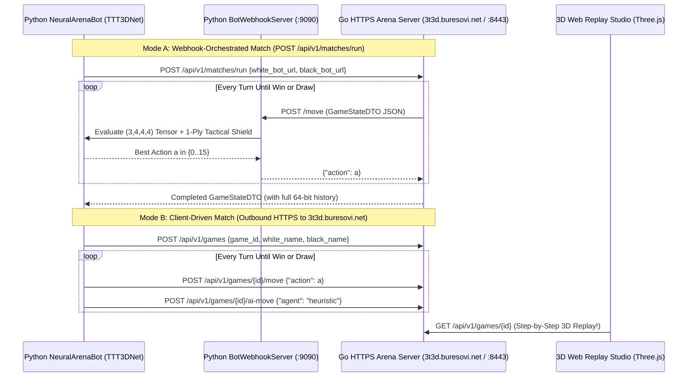

# IMPLEMENTATION — PHASE 5: Remote AI Battle Server, Hybrid Tactical-Neural Bot & 3D Arena Evaluation

## 1. Success Criteria for Phase 5

Phase 5 completes the 5-phase 3T3D AI/ML curriculum and is verified when **all** of the following criteria are met:

1. **PyTorch Neural Arena Bot & Webhook Service (`python/ttt3d/arena_bot.py`):**
   - Implements `NeuralArenaBot`, wrapping a trained `TTT3DNet` model to consume `GameStateDTO` JSON payloads directly from the Go HTTPS Arena Server (`canonical_tensor`, `valid_moves_mask`, `white_bitboard`, `black_bitboard`, `current_player`).
   - Supports both **Pure Neural Inference** (`use_tactical_lookahead=False`) and **Hybrid Neural + 1-Ply Tactical Shield** (`use_tactical_lookahead=True`), which checks the 76 64-bit winning masks for immediate 1-move wins or forced 1-move blocks and uses `TTT3DNet`'s policy distribution $\pi_\theta(a|s)$ to rank candidate moves.
   - Implements `BotWebhookServer`, an HTTP/HTTPS microservice exposing `POST /move` and `GET /health` that plugs directly into the Go Arena Server's `POST /api/v1/matches/run` webhook orchestrator.

2. **HTTPS Arena Battle Client (`ArenaBattleClient` in `python/ttt3d/arena_bot.py`):**
   - Connects over HTTPS (supporting both local self-signed TLS certificates and production Let's Encrypt certificates at `https://3t3d.buresovi.net`).
   - Supports **Mode A — Webhook-Orchestrated Matches (`POST /api/v1/matches/run`)**: The Go Arena Server pushes board states to `white_bot_url` and `black_bot_url` on each turn.
   - Supports **Mode B — Client-Driven Turn-Based Matches (`play_client_match`)**: The Python bot creates a named game on any remote HTTPS Arena Server, submits its moves via `POST /api/v1/games/{id}/move`, triggers opponent moves via `POST /api/v1/games/{id}/ai-move` (or another bot), and persists the complete match history on the server for step-by-step 3D Web UI replay.
   - Supports multi-game tournament evaluation (`run_tournament`) alternating White and Black to measure win/draw/loss rates and Elo/score percentages.

3. **End-to-End HTTPS Battle & Rule Integration Tests (`python/tests/test_https_battle_integration.py`):**
   - Spins up the real Go `cmd/arena-server` binary over **HTTPS (TLS)** and verifies:
     - All game rules defined in `SPECIFICATION.md` Section 4.3 over HTTPS from Python (Rule 2.1 Grid bounds, Rule 2.2 Turn alternation & out-of-turn move rejection, Rule 2.3a Gravity landing heights, Rule 2.3b Full column rejection, Rule 2.4a All 76 winning lines & post-win move rejection, Rule 2.4b 64-move Draw).
     - Live `BotWebhookServer` vs. Go built-in bot matches orchestrated via `POST /api/v1/matches/run`.
     - Live Client-Driven matches (`play_client_match`) and multi-game tournaments (`run_tournament`) where the trained PyTorch `NeuralArenaBot` battles `random`, `heuristic`, and `mcts` opponents and records complete 3D replay logs.
   - Achieves **$\ge 90\%$ statement coverage** across both Python (`pytest --cov=python/ttt3d --cov-fail-under=90`) and Go (`go test`).

---

## 2. Tutor Discussion: Deploying & Evaluating Game AI in Production Arenas

### 2.1 Webhook-Push vs. Client-Pull Battle Topologies
In distributed AI competitions and production game servers, there are two distinct ways an external Neural Network bot interacts with the central Arena Server:

| Pattern | How It Works | Best Used When... | Network Requirement |
| :--- | :--- | :--- | :--- |
| **1. Webhook Push (`POST /api/v1/matches/run`)** | Arena Server acts as the central referee loop, sending `POST` requests with `GameStateDTO` to `white_bot_url` and `black_bot_url` and enforcing strict per-move timeouts (`timeout_ms`). | Both bots run inside the same cluster/LAN or expose reachable HTTPS endpoints. | Arena Server must be able to open outbound HTTP/HTTPS connections to each bot's URL. |
| **2. Client-Driven Pull (`play_client_match`)** | The Python bot initiates outbound HTTPS requests to the Arena Server (`POST /api/v1/games/{id}/move` and `/ai-move`), driving the game loop from the client side. | The Python bot runs on a developer laptop (behind NAT/firewall) battling against a public cloud Arena Server like **`https://3t3d.buresovi.net`**. | Only outbound HTTPS (`443`) from the laptop to `https://3t3d.buresovi.net` is needed! |

By supporting **both** patterns in [`python/ttt3d/arena_bot.py`](file:///Users/pavelbures/Documents/antigravity/noble-brahmagupta/python/ttt3d/arena_bot.py), our PyTorch agent can participate in cluster-internal webhook tournaments *and* push live games from a local machine directly to `https://3t3d.buresovi.net` for instant 3D visualization.

### 2.2 Why Combine a Neural Network with a 1-Ply Tactical Shield?
A key lesson in practical Reinforcement Learning is understanding the complementary strengths of **Pattern Recognition (Neural Networks)** and **Exact Verification (Bitboard Search)**:
- **What `TTT3DNet` does best:** In the opening and midgame, no 1-ply win exists. `TTT3DNet` evaluates all 64 cells simultaneously through its 3D convolutional filters, favoring central column control and multi-directional 3D setups.
- **Where pure policy networks are vulnerable:** Because a neural network outputs smooth probabilities via `softmax`, even a well-trained policy head might assign $92\%$ probability to a subtle 3D diagonal block and $8\%$ to a positional move—or miss a rare 3D corner-to-corner threat it hasn't seen enough times in the replay buffer. Against a tactical opponent (`HeuristicAgent`), a single missed block in a 35-move game means instant defeat.
- **The Hybrid Solution (`use_tactical_lookahead=True`):**
  1. Using fast 64-bit bitboard operations (`WIN_LINE_MASKS`), check if any legal action $a \in \lbrace 0..15 \rbrace$ immediately completes a 4-in-a-row for the active player. If multiple winning moves exist, pick the one with the highest neural policy probability $\pi_\theta(a|s)$.
  2. Otherwise, check if the opponent has any legal action that would win on their next turn. If so, restrict candidate moves to those that block the opponent's immediate win (again ranked by $\pi_\theta(a|s)$).
  3. On all other turns ($\sim 85\%$ of moves), select the action using `TTT3DNet`'s policy distribution $\pi_\theta(a|s)$.

### 2.3 Fair AI Benchmarking: Controlling for First-Player Advantage
In $4 \times 4 \times 4$ Tic-Tac-Toe (as in standard Qubic and Connect-Four), the first player (`WHITE`) has a theoretical initiative advantage. Therefore:
- Every evaluation benchmark in `run_tournament` plays **paired matches**, alternating the Neural Bot between `WHITE` (even-indexed games) and `BLACK` (odd-indexed games).
- Aggregate performance is reported using the standard chess/AlphaZero fractional score:
  $$\text{Score} = \frac{W + 0.5 \cdot D}{N} \in [0.0, 1.0]$$

---

## 3. Detailed Architecture

