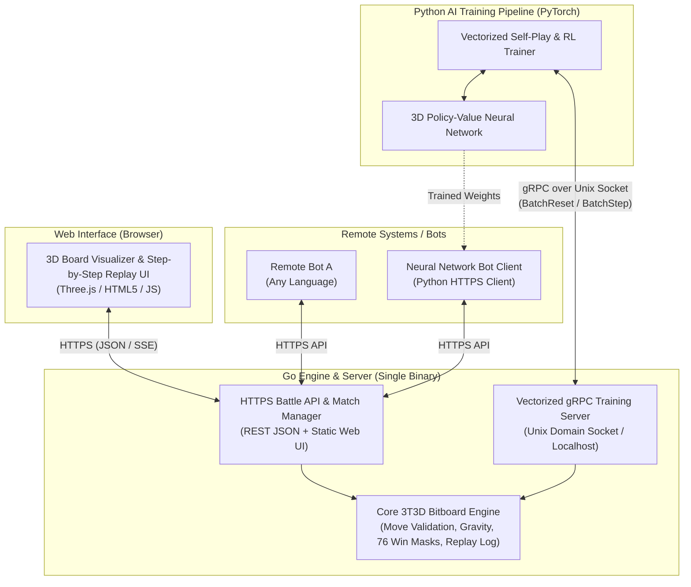

# 3T3D — 3D Gravity Tic-Tac-Toe & Neural Network AI
## Phase 1: Project Specification

---

## 1. Business Case & Overview
**3T3D** is a two-player 3D strategy game played on a $4 \times 4 \times 4$ vertical-gravity grid (64 positions). The objective of this project is twofold:
1. Build a high-performance **Go (Golang) Game Engine & Arena Server** that supports remote bot battles over **HTTPS**, an interactive **3D Web Visualization & Step-by-Step Replay UI**, and a high-throughput **Vectorized gRPC Local Training Interface**.
2. Design and train a **Deep Reinforcement Learning / Neural Network AI (Python + PyTorch)** that learns to master 3T3D through self-play and search, and can compete remotely via the HTTPS Battle API.

---

## 2. Game Rules & Domain Specification

### 2.1 The 3D Grid (State Space)
* **Dimensions:** $4 \times 4 \times 4$ discrete coordinates $(x, y, z)$ where:
  * $x \in \lbrace 0, 1, 2, 3 \rbrace$ (Width / Column)
  * $y \in \lbrace 0, 1, 2, 3 \rbrace$ (Depth / Row)
  * $z \in \lbrace 0, 1, 2, 3 \rbrace$ (Height / Level, where $z = 0$ is the bottom layer and $z = 3$ is the top layer).
* **Bitboard Mapping:** Because $4 \times 4 \times 4 = 64$, the entire 3D grid maps bijectively to the 64 bits of an unsigned 64-bit integer (`uint64`):

$$\text{bitIndex}(x, y, z) = 16z + 4y + x \in \lbrace 0, \dots, 63 \rbrace$$

* **Complete Board State:** Represented compactly by two `uint64` bitboards:
  * `White uint64`: Bits set to `1` where White balls are placed.
  * `Black uint64`: Bits set to `1` where Black balls are placed.

### 2.2 Players & Turn Order
* Two players (`WHITE = 1`, `BLACK = 2`) alternate turns placing one ball of their color per round.
* `WHITE` always makes the first move on an empty board.

### 2.3 Action Space & Gravity Rule
* **Action Selection:** On their turn, a player chooses an $(x, y)$ vertical column/peg, encoded as a discrete action $a \in \lbrace 0, \dots, 15 \rbrace$:

$$a = 4y + x$$

* **Gravity Resolution:** A ball placed in column $(x, y)$ falls to the lowest unoccupied $z$ coordinate:

$$z = \min \lbrace k \in \lbrace 0, 1, 2, 3 \rbrace \mid \text{bitIndex}(x, y, k) \notin (\text{White} \cup \text{Black}) \rbrace$$

* **Move Legality:** An action $a = (x, y)$ is legal if and only if the top cell $(x, y, 3)$ is empty. The set of legal moves for any board state is represented as a 16-bit mask (`uint16`).

### 2.4 Terminal Conditions (Win / Draw)
* **Win Condition:** A player wins immediately upon occupying 4 collinear coordinates along any direction. In a $4 \times 4 \times 4$ cube, there are exactly **76 winning lines** (precomputed as `[76]uint64` bitmasks):
  * **48 Orthogonal lines:** 16 along $X$, 16 along $Y$, 16 along $Z$ (vertical columns).
  * **24 Planar diagonals:** 8 in $XY$ planes, 8 in $XZ$ planes, 8 in $YZ$ planes.
  * **4 Space diagonals:** 3D corner-to-opposite-corner diagonals through the cube's interior.
* **Draw Condition:** All 64 positions are occupied (`White | Black == 0xFFFFFFFFFFFFFFFF`) and neither player has completed a winning line.

---

## 3. System Architecture

### 3.1 Layer 1: Core Engine (`golang` — `internal/engine`)
* **Zero-allocation Bitboard State:** Fast operations for `ApplyMove(action uint8)`, `ValidMovesMask() uint16`, `CheckWin() (winner, winLineMask uint64)`, and `Clone()`.
* **Canonical State Export:** Generates player-relative observation tensors (current player's pieces, opponent's pieces) for Neural Network consumption.
* **Deterministic Replay History:** Stores the ordered sequence of moves $a_0, a_1, \dots, a_{T-1}$ and resulting 3D coordinates $(x_t, y_t, z_t)$ so any game can be reconstructed step-by-step from move $0$ to $T$.

### 3.2 Layer 2: Vectorized gRPC Training Service (`golang` $\leftrightarrow$ `python` — `proto/env.proto`)
* **Transport:** gRPC over **Unix Domain Sockets** (`unix:///tmp/3t3d_train.sock`) for minimal local latency, with optional TCP fallback.
* **Vectorized Environment Management:** Go maintains a pool of $N$ concurrent environments (e.g., $N = 256$ or $512$).
* **Core RPCs:**
  * `InitPool(BatchConfig) -> BatchObservation`: Initializes $N$ games in parallel.
  * `BatchStep(BatchActionRequest) -> BatchStepResponse`: Applies $N$ actions simultaneously across the $N$ games, computes rewards ($+1$ win, $-1$ loss, $0$ draw/ongoing), automatically resets terminal games (while returning terminal info), and returns packed binary buffers of canonical states and valid move masks.
  * `BatchSimulateMCTS` *(Optional Phase 3/4 Acceleration)*: Can offload fast tree-search rollouts to Go goroutines during AlphaZero-style training.

### 3.3 Layer 3: HTTPS Battle API & Match Server (`golang` — `internal/server`)
* **Security & Transport:** Serves HTTPS (TLS via configurable certificates or auto-generated local dev certs).
* **Battle Modes:**
  1. **Client-Driven (Pull/Turn-based) API:** Remote bots create or join a match, poll or wait for their turn, and submit moves via `POST /api/v1/games/{id}/move`.
  2. **Arena Orchestrator (Webhook Push) API:** The server accepts two remote bot HTTPS endpoints (`white_url`, `black_url`) and orchestrates a match or multi-game tournament by sending the board state to each bot on its turn and enforcing per-move time limits.
* **Replay & Live Spectating Endpoints:**
  * `GET /api/v1/games` — List live and completed matches.
  * `GET /api/v1/games/{id}` — Full game metadata, current state, winning line coordinates, and complete step-by-step move log for replay.

### 3.4 Layer 4: 3D Web Visualization & Step-by-Step Replay (`web/`)
* **3D Interactive Board:** Built with Three.js (or WebGL Canvas), showing the $4 \times 4 \times 4$ pegs, dropped White and Black spheres with lighting/shadows, and coordinate labels.
* **Step-by-Step Replay Controls:**
  * `|<<` (Start), `<` (Step Back), `Play / Pause` (Auto-advance with speed slider), `>` (Step Forward), `>>|` (End).
  * Interactive Move Timeline: Click any move # in the move list to jump directly to that board state.
  * Visual Highlights: Highlights the last placed ball and draws a glowing beam through the 4 winning balls at the end of a game.
* **Human Play Mode:** Allows a user to click a column $(x, y)$ in 3D to play against a bot or another player.

### 3.5 Layer 5: Neural Network AI (`python/` — PyTorch)
* **Input Representation:** A 3D spatial tensor of shape $(C, 4, 4, 4)$ where channels $C$ encode:
  * Channel 0: Current player's balls ($1.0$ where present, $0.0$ elsewhere)
  * Channel 1: Opponent's balls ($1.0$ where present, $0.0$ elsewhere)
  * Channel 2: Playable landing heights ($1.0$ at the exact $(x, y, z)$ gravity landing spots for all legal moves)
* **Network Architecture:** 3D Convolutional Neural Network (3D Conv / ResNet blocks) splitting into two heads:
  * **Policy Head ($\pi$):** Outputs logits over the 16 possible $(x, y)$ actions (masked by legal moves) $\to$ probability distribution of best moves.
  * **Value Head ($v$):** Outputs a scalar in $[-1, +1]$ via $\tanh$, estimating expected game outcome from the current state.
* **Training Paradigm:** Self-Play Reinforcement Learning (PPO and/or AlphaZero-style MCTS + Policy-Value iteration) leveraging 8-fold 3D board symmetry (4 rotations around the $Z$-axis $\times$ 2 mirror reflections) for $8\times$ data efficiency.

---

## 4. Quality Assurance, Testing & Implementation Rules

All code written across every phase of this project must strictly adhere to the following testing and verification rules:

### 4.1 Unit Testing & Code Coverage ($\ge 90\%$)
* **Mandatory Unit Tests:** Every module/package (in both Go and Python) must include comprehensive unit tests created alongside the implementation.
* **Coverage Threshold:** Minimum **90% statement/line code coverage** is required per package:
  * **Go:** Verified via `go test ./... -coverprofile=coverage.out` and `go tool cover -func=coverage.out` ($\ge 90.0\%$).
  * **Python:** Verified via `pytest --cov=. --cov-fail-under=90`.

### 4.2 Integration Testing (HTTPS & gRPC Verification)
* **End-to-End Transport Verification:** All system units must have integration tests. In particular, the core game environment (`env`) must be verified end-to-end over **both** transports:
  1. **Over HTTPS (`internal/server`):** Spinning up the live TLS/HTTPS server and executing full game lifecycles, error handling, and replay retrieval using an HTTPS client.
  2. **Over gRPC (`internal/grpcserver`):** Spinning up the live gRPC server (over Unix Domain Socket / local transport) and executing vectorized batch resets, batch steps, terminal auto-resets, and state tensor verification using a gRPC client.

### 4.3 Complete Game Rule Verification Matrix
Integration tests (over both HTTPS and gRPC) must explicitly verify **all rules of the game** defined in Section 2 of this specification:

| Rule ID | Specification Requirement | Required Integration Test Verification |
| :--- | :--- | :--- |
| **Rule 2.1 (Grid)** | $4 \times 4 \times 4$ grid (64 places), $x,y,z \in \lbrace 0..3 \rbrace$ | Verify out-of-bounds coordinates/actions ($\notin \lbrace 0..15 \rbrace$) are rejected and all 64 cells map accurately to $(x, y, z)$. |
| **Rule 2.2 (Turns)** | Two players (`WHITE`, `BLACK`) alternate in rounds | Verify `WHITE` starts first, turn switches strictly after each valid move, and out-of-turn moves (in HTTPS battle mode) are rejected. |
| **Rule 2.3a (Gravity)** | Ball placed at $(x, y)$ lands at lowest empty $z \in \lbrace 0..3 \rbrace$ | Verify sequential moves in the same $(x, y)$ column land at $z=0, 1, 2, 3$ in order. |
| **Rule 2.3b (Full Column)** | Column with $z=3$ occupied is illegal | Verify placing a 5th ball in the same $(x, y)$ column is rejected as an invalid move and excluded from the legal move mask. |
| **Rule 2.4a (Wins)** | First player with 4-in-a-row in any direction wins | Verify win detection across all 3 geometric classes (and all **76 winning lines**): • Orthogonal ($X$-axis, $Y$-axis, $Z$-axis vertical) • 2D Planar diagonals ($XY$, $XZ$, $YZ$ planes) • 3D Space diagonals (corner-to-opposite-corner) Verify no further moves are allowed once a game is won. |
| **Rule 2.4b (Draw)** | 64 balls placed with no 4-in-a-row results in a Draw | Verify a full 64-move non-winning game sequence terminates in `DRAW` status with $0$ legal moves remaining. |

---

## 5. Implementation Phases & Tutor Curriculum

| Phase | Focus Area | Key Concepts & Deliverables |
| :--- | :--- | :--- |
| **Phase 0** | **Project Specification** *(Completed)* | `SPECIFICATION.md` — Rules definition, Bitboard math, Hybrid Go + Python architecture, gRPC vs. HTTPS separation, 90% coverage & integration test mandate. |
| **Phase 1** | **Go Core Engine & Vectorized gRPC** | `IMPLEMENTATION-PHASE1.md` — Implementing the 64-bit Bitboard engine, precomputing the 76 win masks, unit tests ($\ge 90\%$ coverage), vectorized gRPC server, and gRPC integration tests verifying all game rules. |
| **Phase 2** | **HTTPS Battle Server & 3D Web Replay UI** | `IMPLEMENTATION-PHASE2.md` — Building the Go HTTPS API, unit & HTTPS integration tests verifying all game rules, and the Three.js 3D Web UI with step-by-step replay controls. |
| **Phase 3** | **Baseline Agents & Classical Search** | `IMPLEMENTATION-PHASE3.md` — Building Random, Heuristic (1-ply win/block), and Minimax/MCTS agents with unit/integration tests to benchmark our Neural Network. |
| **Phase 4** | **Neural Network Design & Training Pipeline** | `IMPLEMENTATION-PHASE4.md` — Designing the 3D CNN in PyTorch, connecting to Go via vectorized gRPC, implementing Policy/Value loss, symmetry augmentation, training loop, and $\ge 90\%$ test coverage. |
| **Phase 5** | **Remote AI Battle & Evaluation** | `IMPLEMENTATION-PHASE5.md` — Wrapping the trained PyTorch model in an HTTPS Bot client/server, end-to-end battle integration tests, and watching its games step-by-step in the 3D Web UI. |
